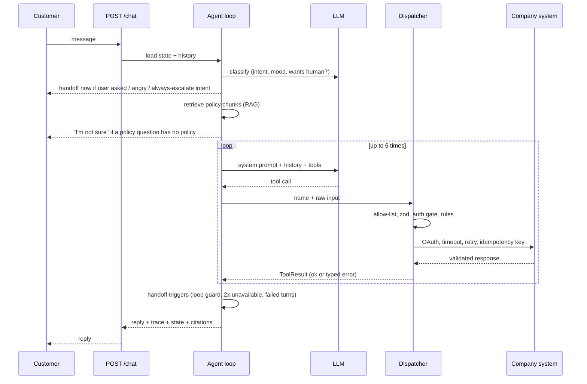

# Architecture

## One turn, end to end

## Layers and what each one owns

| Layer          | Folder                                   | Responsibility                                                                       |
| -------------- | ---------------------------------------- | ------------------------------------------------------------------------------------ |
| Routes         | `backend/src/routes`                     | HTTP, input validation, `{ data }` / `{ error }` envelope                            |
| Authentication | `backend/src/auth`                       | OIDC access-token verification, role permissions, and tenant scoping                  |
| Chat service   | `backend/src/agent/service.ts`           | Conversation load/save, one turn at a time per conversation, persistence             |
| Agent loop     | `backend/src/agent/loop.ts`              | The turn: classify, retrieve, call model, dispatch tools, handoff checks, trace      |
| Dispatcher     | `backend/src/tools/dispatcher`           | The single door for tools: allow-list, zod, auth gate, rules                         |
| Tool library   | `backend/src/tools/{http,auth,security}` | Typed HTTP client, retry/backoff/jitter, token cache, HMAC, PII masking, idempotency |
| Knowledge      | `backend/src/knowledge`                  | Chunk by heading, embed, pgvector search, rerank, relevance gate                     |
| Handoff        | `backend/src/handoff`                    | Triggers (pure), summary, signed webhook, queue                                      |
| Evals          | `backend/src/evals`                      | YAML scenarios, deterministic checks, LLM judge, results in the database             |
| Client modules | `clients/*`                              | Config (data), tools (code), policies, scenarios                                     |

Dependency direction: `frontend -> shared`, `backend -> shared`, `clients -> backend interfaces`. The frontend only talks to the HTTP API.

## What is enforced where

| Guarantee                                                                                     | Enforced by                                                                                                                                                                                | Prompt only? |
| --------------------------------------------------------------------------------------------- | ------------------------------------------------------------------------------------------------------------------------------------------------------------------------------------------ | ------------ |
| No booking/bill tools before verification                                                     | `requiresVerification` rule in the dispatcher                                                                                                                                              | No, code     |
| Only your own booking/bill                                                                    | Ownership check in each tool (`customerId` from verification)                                                                                                                              | No           |
| Change only a flight that was offered, and only after the customer approved that exact change | `change_flight` proposes first; the server stores the proposal and accepts only a later customer message as approval (`agent/approval.ts`), then re-checks the live booking before running | No           |
| One flight change per conversation                                                            | `maxCallsPerConversation` rule                                                                                                                                                             | No           |
| No double booking                                                                             | Idempotency key (derived from conversation + booking + flight) on the client, replay on the server                                                                                         | No           |
| Only allow-listed tools                                                                       | Dispatcher allow-list from the client config                                                                                                                                               | No           |
| Max 6 loop iterations                                                                         | Loop counter, then apology + handoff                                                                                                                                                       | No           |
| Never improvise policy                                                                        | Relevance gate in retrieval; deterministic fallback reply without calling the model                                                                                                        | No           |
| Tone, plain language                                                                          | System prompt + LLM judge in evals                                                                                                                                                         | Yes          |

## Retried chat requests

The web and voice clients send one required `Idempotency-Key` per logical customer turn. The backend
reserves that key in `chat_request_keys`, scoped to the tenant, and stores the completed response for 30 days.
Concurrent requests with the same key wait for and replay the first result; reusing a key with a
different message or conversation is rejected with HTTP 409. A new key always means a new turn, even
when the customer repeats the same words. The web client retries one network failure with the same
key. Streaming callers receive the saved final reply rather than running the agent again.

## Approval-bound changes and the conversation phase

A tool that changes something (today `change_flight`) declares an `approval.propose` step. The dispatcher runs it against the live booking and gets a one-line summary plus a **binding**: the exact values the customer would be agreeing to (booking, target flight, current flight, changes already made).

1. First call: the dispatcher stores a **proposal** (id, tool, summary, binding, customer, expiry) and returns "awaiting approval". Nothing is changed.
2. Next customer message: before the model is called, the classifier reads that message for a clear yes or no. A yes marks the proposal `approved`. The model cannot do this, and neither can text inside a policy document or tool result.
3. Second call: the tool runs only if the proposal is approved, belongs to this customer, has not expired, and a fresh look at the booking gives the **same binding**. A different flight, or a booking that changed in the meantime, creates a new proposal that needs its own yes.
4. One approval covers one execution. An approval not used in its turn expires.
5. If the booking system times out on the write, the tool reads the booking back: if the change happened it is reported as done (`mutation_reconciled`), otherwise the failure is reported.

The conversation also has an explicit **phase** (`NEW, VERIFYING, VERIFIED, PLANNING, AWAITING_APPROVAL, EXECUTING, COMPLETED, FAILED, CANCELLED, HANDOFF`) that only the engine moves, along the edges in `agent/phase.ts`. An event with no edge from the current phase is refused and audited as `phase_refused`.

Every proposal, approval, rejection, expiry, execution and reconciliation is written to the append-only `audit_events` table (`GET /conversations/:id/audit`).

Limits worth knowing: the yes/no reading is still done by a model (the classifier), but only on the customer's own message and only while a proposal is pending. Per-request token and time budgets are not built yet. See [AUTHENTICATION.md](./AUTHENTICATION.md) for OIDC setup and the server-enforced role and tenant permissions.

## After a handoff: the human side

Once a conversation is handed over, the agent stays out of it. A person works it from the Human Handoffs page: **accept** (claims it), **reply** (saved as a `human` message the customer's chat fetches every few seconds) and **resolve** (closes it and tells the customer). While nobody has accepted, a customer who writes again is told they are in the queue; after acceptance the agent says nothing and the human answers. Accept, every reply (length only, not the text) and resolve are written to the audit log. A reply needs an accepted handoff, and a resolved handoff accepts nothing more.

In OIDC mode, only identities with the tenant-scoped `support:handoff` permission can accept, reply to, or resolve a handoff. The local development mode grants a development-only administrator identity and must not be used in production.

## Data model

`clients`, `conversations` (state as JSON), `messages`, `tool_calls` (tool, input, output, status, latency), `trace_events`, `handoffs`, `knowledge_chunks` (vector(256), source, updated_at), `idempotency_keys`, `eval_runs`, `eval_results`. Schema in `backend/src/database/schema.ts`, migrations generated by drizzle-kit.

## Error handling

Layers never throw across boundaries. Tools return `ToolResult`, the LLM adapter returns `ToolResult`, the dispatcher converts a thrown tool bug into `UNAVAILABLE`. The agent is instructed to explain errors in plain words and never invent data. HTTP errors use `{ error: { code, message } }`.
