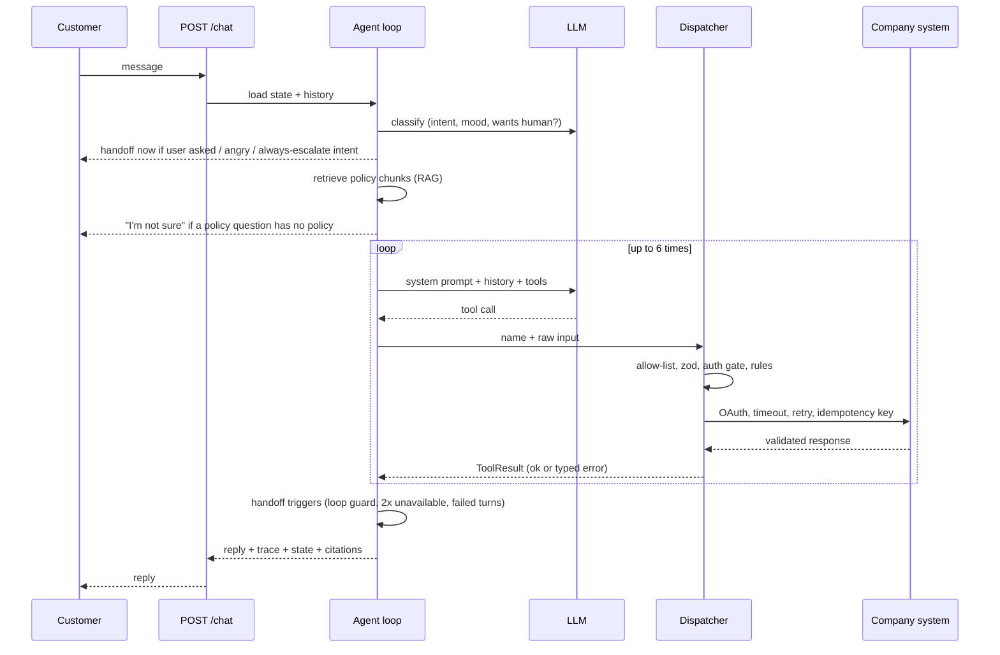

# Architecture

## One turn, end to end

## Layers and what each one owns

| Layer          | Folder                                   | Responsibility                                                                       |
| -------------- | ---------------------------------------- | ------------------------------------------------------------------------------------ |
| Routes         | `backend/src/routes`                     | HTTP, input validation, `{ data }` / `{ error }` envelope                            |
| Chat service   | `backend/src/agent/service.ts`           | Conversation load/save, one turn at a time per conversation, persistence             |
| Agent loop     | `backend/src/agent/loop.ts`              | The turn: classify, retrieve, call model, dispatch tools, handoff checks, trace      |
| Dispatcher     | `backend/src/tools/dispatcher`           | The single door for tools: allow-list, zod, auth gate, rules                         |
| Tool library   | `backend/src/tools/{http,auth,security}` | Typed HTTP client, retry/backoff/jitter, token cache, HMAC, PII masking, idempotency |
| Knowledge      | `backend/src/knowledge`                  | Chunk by heading, embed, pgvector search, rerank, relevance gate                     |
| Handoff        | `backend/src/handoff`                    | Triggers (pure), summary, signed webhook, queue                                      |
| Evals          | `backend/src/evals`                      | YAML scenarios, deterministic checks, LLM judge, results in the database             |
| Client modules | `clients/*`                              | Config (data), tools (code), policies, scenarios                                     |

Dependency direction: `frontend -> shared`, `backend -> shared`, `clients -> backend interfaces`. The frontend only talks to the HTTP API.

## What is enforced where

| Guarantee                                                              | Enforced by                                                                                        | Prompt only? |
| ---------------------------------------------------------------------- | -------------------------------------------------------------------------------------------------- | ------------ |
| No booking/bill tools before verification                              | `requiresVerification` rule in the dispatcher                                                      | No, code     |
| Only your own booking/bill                                             | Ownership check in each tool (`customerId` from verification)                                      | No           |
| Change only a flight that was offered, only with explicit confirmation | `change_flight` input (`customerConfirmed: true`) + offered-list check                             | No           |
| One flight change per conversation                                     | `maxCallsPerConversation` rule                                                                     | No           |
| No double booking                                                      | Idempotency key (derived from conversation + booking + flight) on the client, replay on the server | No           |
| Only allow-listed tools                                                | Dispatcher allow-list from the client config                                                       | No           |
| Max 6 loop iterations                                                  | Loop counter, then apology + handoff                                                               | No           |
| Never improvise policy                                                 | Relevance gate in retrieval; deterministic fallback reply without calling the model                | No           |
| Tone, plain language                                                   | System prompt + LLM judge in evals                                                                 | Yes          |

## Data model

`clients`, `conversations` (state as JSON), `messages`, `tool_calls` (tool, input, output, status, latency), `trace_events`, `handoffs`, `knowledge_chunks` (vector(256), source, updated_at), `idempotency_keys`, `eval_runs`, `eval_results`. Schema in `backend/src/database/schema.ts`, migrations generated by drizzle-kit.

## Error handling

Layers never throw across boundaries. Tools return `ToolResult`, the LLM adapter returns `ToolResult`, the dispatcher converts a thrown tool bug into `UNAVAILABLE`. The agent is instructed to explain errors in plain words and never invent data. HTTP errors use `{ error: { code, message } }`.
